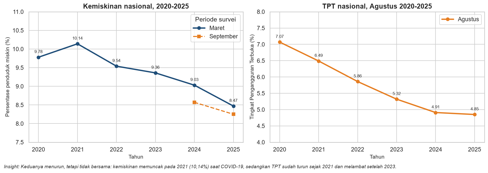
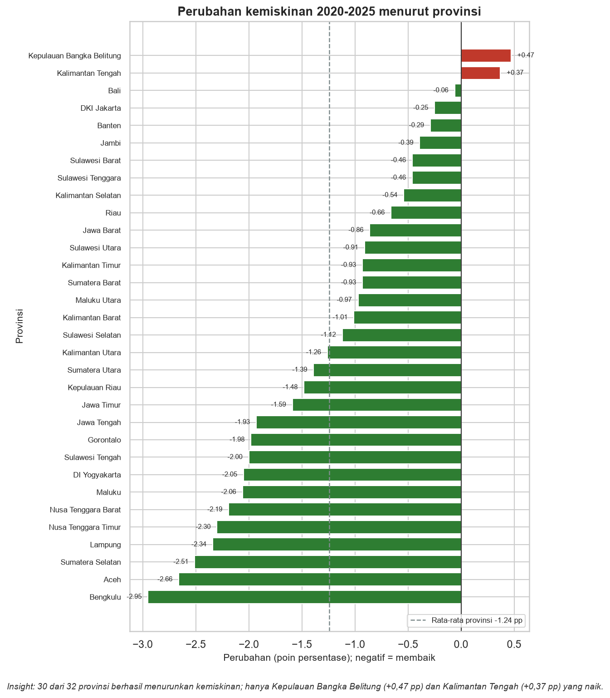
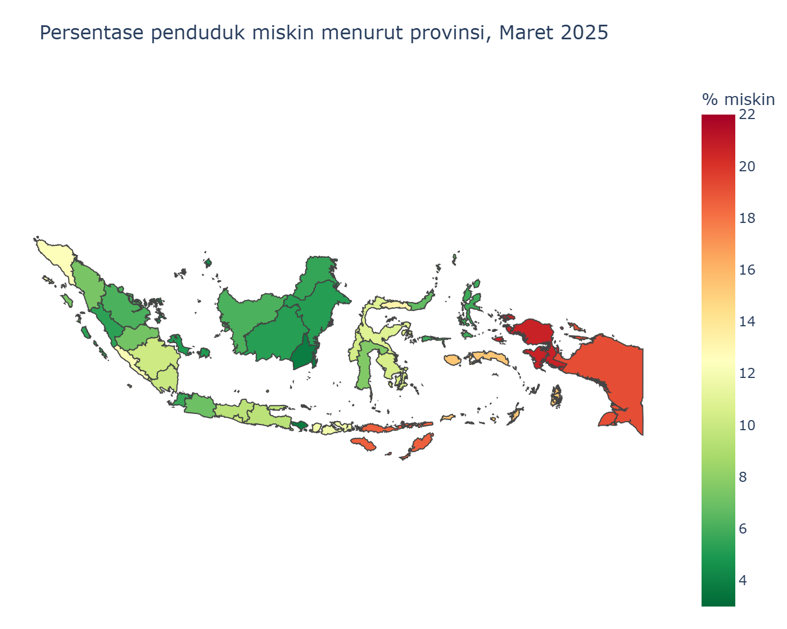
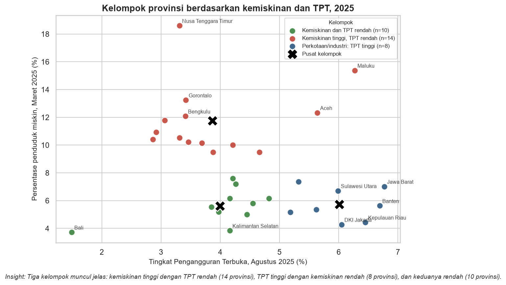

# Kemiskinan & Pengangguran di Indonesia (2020–2025)

Analisis data resmi BPS untuk **38 provinsi** selama lima tahun: bagaimana kemiskinan dan
pengangguran bergerak, di provinsi mana keduanya paling parah, dan mengapa keduanya
**tidak bisa dipakai sebagai pengganti satu sama lain**.


> **Ringkas:** kemiskinan nasional turun dari **9,78%** (Maret 2020) ke **8,47%** (Maret 2025)
> dan TPT turun dari **7,07%** ke **4,85%** (Agustus 2020 → Agustus 2025). Tetapi pada 2025
> kemiskinan antarprovinsi berkisar **3,72% (Bali)** sampai **30,03% (Papua Pegunungan)** —
> sekitar **8 kali lipat**. Korelasi kemiskinan–pengangguran justru **negatif** (r = -0,20).

---

## Pertanyaan yang dijawab

1. Bagaimana tren kemiskinan dan pengangguran nasional 2020–2025?
2. Provinsi mana yang paling miskin dan mana yang penganggurannya paling tinggi?
3. Provinsi mana yang paling cepat membaik, dan mana yang justru memburuk?
4. Apakah kemiskinan dan pengangguran berkorelasi di tingkat provinsi?
5. Kelompok provinsi seperti apa yang muncul dari data?

## Temuan utama

| # | Temuan | Angka |
|---|---|---|
| 1 | Kemiskinan nasional turun 1,31 poin persentase dalam 5 tahun, terendah dalam seri | 9,78% → 8,47% |
| 2 | TPT nasional turun lebih cepat daripada kemiskinan | 7,07% → 4,85% (-2,22 pp) |
| 3 | Kemiskinan memuncak pada 2021, tahun pertama pandemi penuh | 10,14% |
| 4 | Ketimpangan antarwilayah sangat besar | 3,72% vs 30,03% (8,1x) |
| 5 | 30 dari 32 provinsi sebanding menurunkan kemiskinan | hanya 2 naik |
| 6 | Seluruh 32 provinsi sebanding menurunkan TPT | 32 dari 32 |
| 7 | Kemiskinan dan pengangguran **tidak searah** | r = -0,20 (2025) |
| 8 | Tiga klaster provinsi muncul dari data | 14 / 8 / 10 provinsi |

**Dua provinsi yang kemiskinannya naik:** Kepulauan Bangka Belitung (+0,47 pp) dan
Kalimantan Tengah (+0,37 pp).

**Sepuluh provinsi termiskin 2025:** Papua Pegunungan (30,03%), Papua Tengah (28,90%),
Papua Barat (20,66%), Papua Selatan (19,71%), Papua (19,16%), NTT (18,60%),
Papua Barat Daya (17,95%), Maluku (15,38%), Gorontalo (13,24%), Aceh (12,33%).

### Mengapa korelasinya negatif?

Provinsi dengan TPT tinggi (Jawa Barat 6,77%, Banten 6,69%, Kepulauan Riau 6,45%,
DKI Jakarta 6,05%) justru punya kemiskinan rendah. Sebaliknya NTT (TPT 3,31%),
Sulawesi Tengah (2,92%), dan Sulawesi Barat (2,86%) miskin tetapi pengangguran terbukanya rendah.

Penjelasannya: **TPT hanya menghitung orang yang benar-benar mencari kerja dan tidak bekerja.**
Di daerah miskin, orang umumnya tetap bekerja — tetapi di sektor informal, sebagai pekerja
keluarga, atau dengan jam kerja sedikit. Mereka tidak masuk statistik pengangguran, tetapi
tetap miskin. Artinya kemiskinan dan pengangguran adalah **dua masalah berbeda** dengan
kebijakan yang berbeda pula.

## Grafik utama

**Tren nasional 2020–2025**



**Perubahan kemiskinan tiap provinsi**



**Peta kemiskinan 2025**



**Klaster provinsi berdasarkan kemiskinan dan TPT**



## Struktur proyek

```
indonesia-poverty-unemployment-analysis/
├── README.md
├── requirements.txt
├── LICENSE
├── .gitignore
├── data/
│   ├── raw/                                   # data mentah dari BPS (apa adanya)
│   │   ├── kemiskinan_bps_2020_2025.csv
│   │   ├── tpt_bps_2020_2025.csv
│   │   ├── nasional_bps_2020_2025.csv
│   │   └── README.md
│   ├── processed/                             # data bersih siap analisis
│   │   └── panel_kemiskinan_pengangguran_2020_2025.csv
│   └── geojson/
│       └── indonesia_provinces.geojson        # batas 34 provinsi untuk peta
├── notebooks/
│   └── analisis_kemiskinan_pengangguran.ipynb # analisis lengkap 11 bagian
├── images/                                    # grafik hasil ekspor notebook
└── scripts/
    └── build_dataset.py                       # pembuat file data mentah dari angka BPS
```

## Isi notebook

| Bagian | Isi |
|---|---|
| 1 | Pendahuluan, pertanyaan analisis, sumber data, glosarium |
| 2 | Import library dan pengaturan |
| 3 | Memuat data dan pemeriksaan awal (kualitas data) |
| 4 | Pembersihan nama provinsi dan pembentukan tabel panel |
| 5 | EDA: statistik deskriptif, sebaran, hubungan awal |
| 6 | Analisis perubahan 2020–2025 |
| 7 | Korelasi (Pearson & Spearman) |
| 8 | Clustering K-Means dan pemilihan jumlah klaster |
| 9 | Visualisasi lanjutan: heatmap, peta, Plotly |
| 10 | Kesimpulan dan rekomendasi |
| 11 | Keterbatasan dan langkah selanjutnya |

Setiap grafik dilengkapi judul, label sumbu, dan satu kalimat *insight*.

## Sumber data

| Indikator | Sumber | Periode | Satuan |
|---|---|---|---|
| Persentase penduduk miskin | [BPS — Jumlah dan Persentase Penduduk Miskin Menurut Provinsi](https://www.bps.go.id/id/statistics-table/3/UkVkWGJVZFNWakl6VWxKVFQwWjVWeTlSZDNabVFUMDkjMw%3D%3D/) | Maret 2020–2025, September 2024–2025 | % penduduk |
| Tingkat Pengangguran Terbuka (TPT) | [BPS — TPT dan TPAK Menurut Provinsi](https://www.bps.go.id/id/statistics-table/3/V2pOVWJWcHJURGg0U2pONFJYaExhVXB0MUhacVFUMDkjMyMwMDAw/) | Agustus 2020–2025 | % angkatan kerja |
| Batas wilayah provinsi | GeoJSON 34 provinsi | — | — |

- Tanggal akses: **22 Oktober 2026**.
- Semua angka adalah data resmi BPS; **tidak ada data sintetis** dalam analisis.
- Rincian kolom dan catatan kualitas data ada di [`data/raw/README.md`](data/raw/README.md).

## Metode singkat

- **Panel data** provinsi × tahun (212 observasi) hasil penggabungan dua tabel BPS.
- **Pembersihan**: penyeragaman nama provinsi (`KEP. RIAU` → `Kepulauan Riau`) dengan
  fungsi khusus, lalu `merge` dengan validasi `one_to_one`.
- **Perubahan** dihitung dalam **poin persentase**, bukan persentase relatif.
- **Provinsi tidak sebanding** (Papua dan Papua Barat) dikeluarkan dari peringkat perubahan
  karena wilayahnya dimekarkan pada 2022; empat provinsi baru hanya punya data 2024–2025.
- **Korelasi**: Pearson dan Spearman, dengan pembanding tanpa provinsi ekstrem.
- **Clustering**: K-Means pada data yang di-*standardize*, pemilihan `k` dengan elbow +
  silhouette, lalu `k = 3` dipilih untuk interpretabilitas.
- **Peta**: Plotly choropleth dengan GeoJSON lokal (tanpa butuh koneksi internet).

## Cara menjalankan

```bash
# 1. Buat virtual environment (opsional tetapi disarankan)
python -m venv .venv
# Windows
.venv\Scripts\activate
# macOS / Linux
source .venv/bin/activate

# 2. Pasang dependensi
pip install -r requirements.txt

# 3. Buka notebook
jupyter lab notebooks/analisis_kemiskinan_pengangguran.ipynb
```

Menjalankan ulang seluruh notebook dari terminal:

```bash
jupyter nbconvert --to notebook --execute --inplace \
  notebooks/analisis_kemiskinan_pengangguran.ipynb
```

> Grafik Plotly disimpan sebagai gambar agar tetap terlihat di GitHub. Untuk versi interaktif,
> ubah `pio.renderers.default = "png"` menjadi `"notebook"` di bagian 2 notebook.

## Keterbatasan

- Hanya dua indikator; kesehatan, pendidikan, ketimpangan, dan akses layanan belum tercakup.
- Data agregat provinsi tidak bisa dipakai untuk menyimpulkan perilaku individu
  (*ecological fallacy*).
- Periode survei berbeda: kemiskinan Maret/September, TPT Agustus — ada faktor musiman.
- 2020–2021 adalah masa pandemi, sehingga sebagian perbaikan adalah pemulihan.
- Empat provinsi baru Papua hanya punya data 2024–2025.
- Papua dan Papua Barat tidak sebanding antarwaktu karena pemekaran wilayah 2022.
- Tidak ada jumlah penduduk absolut, sehingga jumlah orang miskin tidak bisa dihitung.
- Peta hanya mencakup 34 provinsi (batas wilayah sebelum pemekaran).
- Korelasi bukan kausalitas.

## Langkah selanjutnya

- Menambahkan IPM, PDRB per kapita, gini ratio, TPAK, proporsi pekerja informal, dan UMP.
- Menganalisis pada tingkat kabupaten/kota.
- Regresi data panel dengan *fixed effects*.
- Proyeksi kemiskinan 2026–2027 (deret waktu).
- Validasi klaster dengan hierarchical clustering / GMM dan *bootstrap*.
- Dashboard Streamlit untuk pengambil kebijakan.

## Kalimat untuk CV

**Bahasa Indonesia**

- Menganalisis data resmi BPS 2020–2025 untuk 38 provinsi dan menemukan bahwa kemiskinan
  dan pengangguran tidak bergerak searah (r = -0,20), sehingga keduanya memerlukan strategi
  kebijakan yang berbeda.
- Membangun pipeline analisis *end-to-end* dengan Python (pandas, scikit-learn, Plotly):
  pembersihan nama provinsi, penggabungan panel 212 observasi, analisis perubahan, korelasi,
  dan segmentasi K-Means menjadi tiga klaster provinsi.
- Menyusun 11 visualisasi dan laporan *insight* yang mengidentifikasi 10 provinsi prioritas
  pengentasan kemiskinan serta dua provinsi yang kemiskinannya justru naik
  (Kepulauan Bangka Belitung dan Kalimantan Tengah).

**English**

- Analyzed official BPS data (2020–2025) covering 38 Indonesian provinces and found that
  poverty and unemployment do not move together (r = -0.20), implying two distinct policy
  responses.
- Built an end-to-end Python pipeline (pandas, scikit-learn, Plotly) covering province-name
  cleaning, a 212-observation panel merge, change analysis, correlation, and K-Means
  segmentation into three provincial clusters.
- Produced 11 visualizations and an insight report identifying 10 priority provinces for
  poverty reduction and two provinces where poverty actually increased.

## Lisensi

MIT — lihat [`LICENSE`](LICENSE).
